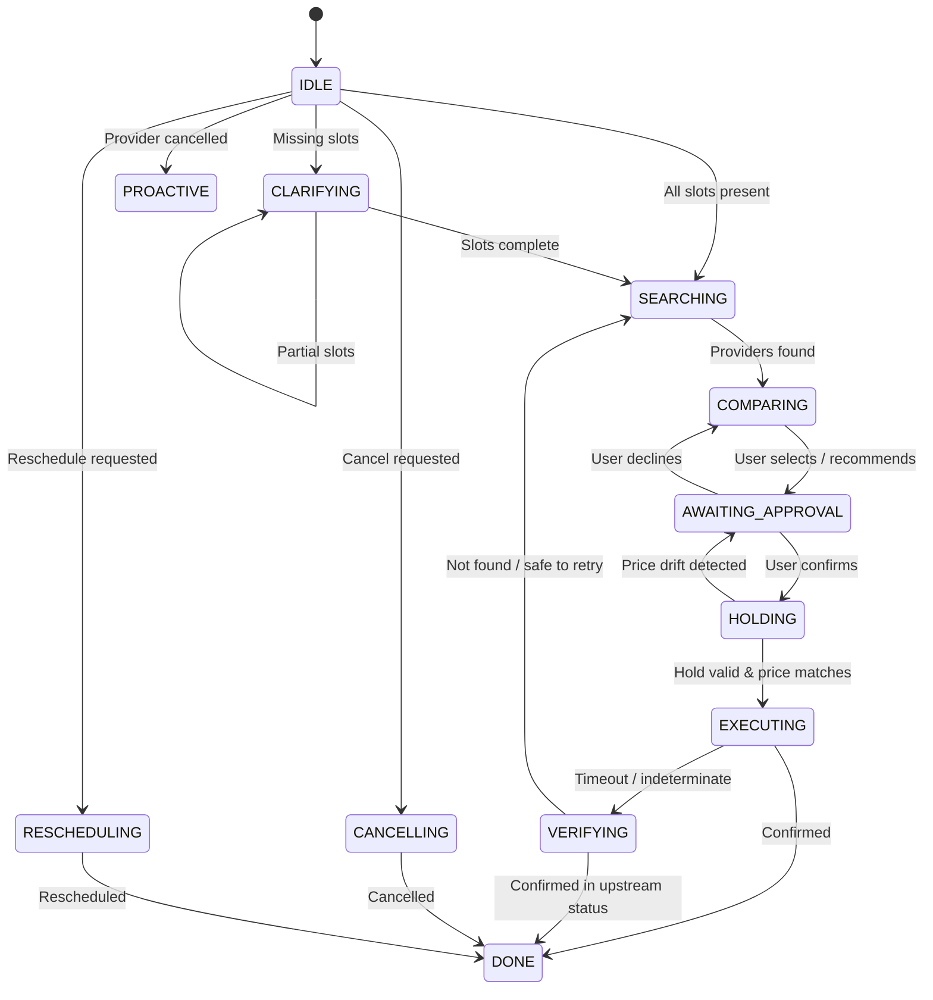

# DESIGN NOTE — Errand Agent

## 1. State Model & Tool Delegation
The Errand Agent is governed by a deterministic 13-state machine (`IDLE`, `CLARIFYING`, `SEARCHING`, `COMPARING`, `AWAITING_APPROVAL`, `HOLDING`, `EXECUTING`, `VERIFYING`, `DONE`, `FAILED`, `CANCELLING`, `RESCHEDULING`, `PROACTIVE`). Mutating tools (`book`, `cancel`, `reschedule`) and slot holds are strictly gated by application code in designated executing states, preventing hallucinated or premature execution.
- **Model-Driven Non-Mutating Tools**: In non-terminal states (`IDLE`, `CLARIFYING`, `COMPARING`), the model can autonomously invoke read-only discovery tools (`search_providers`, `get_provider`, `list_bookings`). The Orchestrator strictly validates each tool against the FSM allowlist and safety constraints before dispatch.
- **Trade-offs**: *Flexibility*: The model can freely inspect provider reviews or check prior history without rigid procedural branching. *Safety*: Strict allowlist validation, bounded budget accounting, and output sanitization within `<DATA>` tags neutralize untrusted injection attempts and prevent resource exhaustion.



## 2. Approval Enforcement
Every mutating side-effect requires explicit user confirmation processed via whitelist matching on raw user input (`yes`, `confirm`, `proceed`), with hedge words (`but`, `except`, `cheaper`) safely routed to ambiguous clarification. Application code mints a single-use `ApprovalGrant` cryptographically bound via HMAC/SHA-256 to `(action, provider_id, slot, quoted_price, booking_id)`. The `Executor` verifies this grant before invoking any mutating tool and invalidates it immediately upon execution. If price drift occurs (`hold.quoted_price != approved_price`), the grant is revoked, and the system prompts the user to re-approve the updated price.

## 3. Idempotency & Recovery
To guarantee fault-tolerance across transient network drops and timeouts, idempotency keys are deterministically derived via SHA-256 from `(user_id, action, provider_id, slot, attempt)`. Prior to calling mutating tools, intent is written to an SQLite Write-Ahead Log (`intent_log`). If `book()` times out, the agent transitions to `VERIFYING` and queries `get_booking_status(idempotency_key)`—the authoritative source of truth. If the booking succeeded upstream, it transitions to `DONE` without duplicate booking; if not found, it increments the attempt counter or re-searches. Startup reconciliation verifies all pending WAL records before accepting new turns.

## 4. Persistent Memory & Context Budgeting
User facts are persisted in SQLite (`memories`) with provenance labeling (`explicit` vs `inferred`) and confirmation flags (`confirmed`). Unconfirmed inferred memories and soft-deleted facts are excluded at the SQL level, ensuring zero prompt leakage. Context is strictly budgeted at 4000 tokens using `tiktoken` (`cl100k_base`), logging per-turn `ContextManifest` records detailing exact memory inclusions and exclusions.

---

## 5. Annotated Live Trace Excerpt (Scenario S10: Timeout-After-Success)
The following verbatim lines from `traces/s10_timeout_after_success.jsonl` capture real inference through `qwen2.5:7b` via Ollama, showing timeout recovery verified via source of truth:

```json
{"timestamp": "2026-11-02T22:14:39.935343+00:00", "turn_id": 1, "event_type": "user_input", "message": "Find a plumber in Koramangala this week"}
{"timestamp": "2026-11-02T22:14:45.491564+00:00", "turn_id": 1, "event_type": "model_response", "trigger": "search_providers", "model_name": "qwen2.5:7b", "prompt_tokens": 387, "completion_tokens": 120, "latency_ms": 5552.29, "message": "I will find a plumber available in Koramangala this week for you..."}
{"timestamp": "2026-11-02T22:14:45.491994+00:00", "turn_id": 1, "event_type": "tool_call", "tool_name": "list_bookings", "tool_args": {"service": "plumber", "area": "Koramangala", "date_range": "this week"}}
{"timestamp": "2026-11-02T22:14:45.492564+00:00", "turn_id": 1, "event_type": "state_transition", "from_state": "IDLE", "to_state": "SEARCHING", "trigger": "slots_complete"}
{"timestamp": "2026-11-02T22:14:45.492830+00:00", "turn_id": 1, "event_type": "state_transition", "from_state": "COMPARING", "to_state": "AWAITING_APPROVAL", "trigger": "propose_provider"}
{"timestamp": "2026-11-02T22:14:45.493061+00:00", "turn_id": 1, "event_type": "agent_output", "message": "I found 5 providers. I recommend QuickFix Plumbing (4.7★, ₹1200.00)... Shall I go ahead and book this for you?"}
{"timestamp": "2026-11-02T22:14:45.493342+00:00", "turn_id": 2, "event_type": "user_input", "message": "yes"}
{"timestamp": "2026-11-02T22:14:45.493615+00:00", "turn_id": 2, "event_type": "state_transition", "from_state": "HOLDING", "to_state": "EXECUTING", "trigger": "proceed_with_booking"}
{"timestamp": "2026-11-02T22:14:45.493938+00:00", "turn_id": 2, "event_type": "state_transition", "from_state": "EXECUTING", "to_state": "VERIFYING", "trigger": "timeout_verify"}
{"timestamp": "2026-11-02T22:14:45.494058+00:00", "turn_id": 2, "event_type": "state_transition", "from_state": "VERIFYING", "to_state": "DONE", "trigger": "timeout_recovered_confirmed"}
{"timestamp": "2026-11-02T22:14:45.494141+00:00", "turn_id": 2, "event_type": "agent_output", "message": "Success! Your booking BKG-M-01-0001 was confirmed upstream after resolving timeout."}
```
*Annotation*: In turn 1, `qwen2.5:7b` autonomously chose `list_bookings` (non-mutating), validated by Orchestrator. In turn 2, `book()` timed out; the agent transitioned `EXECUTING -> VERIFYING`, confirmed booking status upstream, and reached `DONE` without duplicate booking or re-asking.
