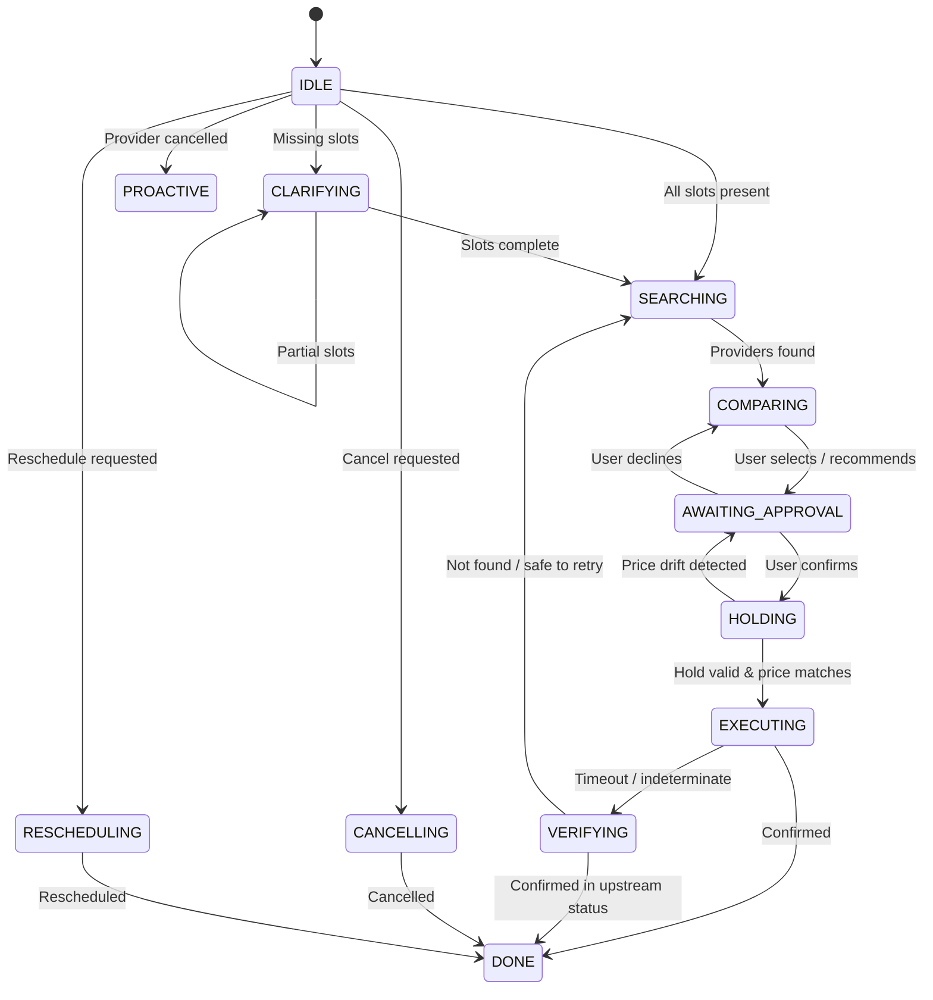

# DESIGN NOTE — Errand Agent

## 1. State Model
The Errand Agent is governed by a deterministic 13-state machine (`IDLE`, `CLARIFYING`, `SEARCHING`, `COMPARING`, `AWAITING_APPROVAL`, `HOLDING`, `EXECUTING`, `VERIFYING`, `DONE`, `FAILED`, `CANCELLING`, `RESCHEDULING`, `PROACTIVE`). The LLM operates solely as an NLU extraction engine for slot filling and provider summarization; all state transitions, guard conditions, and tool allowlists are enforced deterministically in application code. Mutating tools (`book`, `cancel`, `reschedule`) are strictly prohibited outside their designated executing states, preventing hallucinated or premature execution.



## 2. Approval Enforcement
Every external mutating side-effect requires explicit user confirmation processed via whitelist pattern matching on raw user input (`yes`, `confirm`, `proceed`), never through unverified LLM interpretations. When approved, application code mints a single-use `ApprovalGrant` cryptographically bound via HMAC/SHA-256 to the exact tuple `(action, provider_id, slot, quoted_price, booking_id)`. The `Executor` verifies this cryptographic grant before invoking any mutating tool and immediately invalidates it upon execution to prevent replay. If the slot hold reports price drift (`hold.quoted_price != approved_price`), the grant is revoked, and the system reverts to `AWAITING_APPROVAL` with the updated price.

## 3. Idempotency & Recovery
To guarantee fault-tolerant side effects across transient network failures and timeouts, idempotency keys are deterministically derived via SHA-256 from `(user_id, action, provider_id, slot, attempt)`. Prior to calling mutating tools, intent is written to an SQLite Write-Ahead Log (`intent_log`). If `book()` returns a timeout, the agent treats the outcome as indeterminate, transitions to `VERIFYING`, and queries `get_booking_status(idempotency_key)`—the authoritative source of truth. If the booking succeeded upstream, it transitions directly to `DONE` without retrying; if not found, it increments the attempt counter or safely re-searches. On startup, reconciliation checks all pending WAL records and queries status before accepting new turns.

## 4. Persistent Memory
User preferences and facts are persisted in an SQLite store (`memories`) with strict provenance labeling (`explicit` vs `inferred`) and confirmation flags (`confirmed`). Unconfirmed inferred memories and soft-deleted facts (`valid_to IS NOT NULL`) are strictly excluded at the SQL query level, guaranteeing they never leak into prompt context. Active facts are ranked by token budget and relevance before inclusion in `<DATA>` delimited prompt sections. Users can inspect ("show memories"), correct ("update area to Indiranagar"), or delete ("forget my budget") memories at any time.

## 5. Observability & Context Management
Every turn logs structured JSONL events with RFC 3339 timestamps to disk. PII (phone numbers, emails) is redacted via regex before persistence. Context is capped at 4000 tokens using `tiktoken` (`cl100k_base`), dynamically allocating space across system prompts, active memories, summarized history, and recent verbatim turns. Every turn logs a `ContextManifest` recording exact token allocations and included/excluded memory facts.

---

## 6. Annotated Trace Excerpt (Scenario S10: Timeout-After-Success)
The following excerpt from `traces/s10_timeout_after_success.jsonl` illustrates how an indeterminate timeout during `book()` is safely resolved via source-of-truth verification without duplicate booking:

```json
{"turn_id": 1, "event_type": "user_input", "message": "Find plumber in Koramangala this week"}
{"turn_id": 1, "event_type": "context_manifest", "context_manifest": {"turn_id": 1, "current_state": "IDLE", "total_tokens": 140, "budget_remaining": 3860}}
{"turn_id": 1, "event_type": "agent_output", "message": "I found 5 providers. I recommend QuickFix Plumbing (4.7★, ₹1200.00) on 2024-01-15T10:00:00. Shall I go ahead and book this for you?"}
{"turn_id": 2, "event_type": "user_input", "message": "yes"}
// [EXECUTING]: book() tool invoked with idempotency_key=e7c6... -> Mock simulates timeout
// [VERIFYING]: Recovery queries get_booking_status(idempotency_key) -> Returns status="confirmed", booking_id="BKG-M-01-0001"
{"turn_id": 2, "event_type": "agent_output", "message": "Success! Your booking BKG-M-01-0001 was confirmed upstream after resolving timeout."}
```
*Annotation*: Notice the agent never issues a duplicate booking request. The authoritative verification confirms the transaction completed during the network drop, cleanly resolving state to `DONE`.

---

## 7. Demo Script Outline (3–5 Minutes)
- **0:00–0:30 (Setup & Architecture)**: Launch agent via CLI (`uv run python -m src.cli --model scripted`). Briefly explain the 13-state deterministic FSM and cryptographic approval barrier.
- **0:30–1:30 (Slot Filling & Search)**: User asks for a plumber in Koramangala. Show the multi-turn slot resolution and provider recommendation with price and rating.
- **1:30–2:30 (Approval Gate & Execution)**: User confirms with "yes". Demonstrate cryptographic `ApprovalGrant` binding, hold verification, and state progression to `DONE`.
- **2:30–3:30 (Timeout Recovery & WAL)**: Trigger Scenario S10 (timeout outcome). Inspect the split-screen JSONL trace showing WAL logging, timeout catch, and authoritative upstream verification.
- **3:30–4:30 (Adversarial Protection & Memory)**: Demonstrate prompt injection defense (review injection sanitized in `<DATA>` tags) and memory management ("what do you remember about me" / "forget").
- **4:30–5:00 (Summary & Verification)**: Run automated evaluation suite (`uv run pytest tests/test_eval.py -v`) showing 27/27 passing scenarios and display `eval_table.md`.
